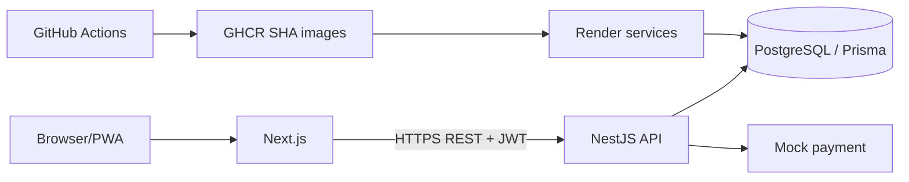

# 3.1 Kiến trúc

## Phân lớp / C4 container
- Presentation: Next.js App Router mobile-first/PWA, same-origin `/api` proxy tới runtime `API_SERVER_URL`.
- Application/domain: NestJS auth, catalog, checkout/payment/orders/health; validation DTO, JWT.
- Persistence: PostgreSQL, Prisma schema/migration/transaction.
- Payment adapter: mock wallet/card, không nhận dữ liệu thẻ.
- Operations: Docker, Compose, GitHub Actions, GHCR, Render HTTPS/private DB, stdout logs, health endpoint.

## Lý do và trade-off
Monorepo đồng bộ code/docs, nhưng dependency graph lớn dần. NestJS REST dễ kiểm tra, cần chia module khi domain mở rộng. PostgreSQL transaction hỗ trợ atomic checkout, nhưng tải cạnh tranh cao cần row locking/conditional decrement. Payment mock tái lập, không thu tiền. Render + GHCR phù hợp container demo; blueprint cần tài khoản và secrets trước khi sinh URL.

Cấu hình runtime bằng env; secret không commit. CORS giới hạn `WEB_ORIGIN`; `/api/health` kiểm tra DB; stdout logs, không ghi token/payment. ADR: [monorepo](adr/001-monorepo.md), [database](adr/002-postgresql-prisma.md), [payment](adr/003-mock-payment.md), [deploy](adr/004-render-deployment.md).
