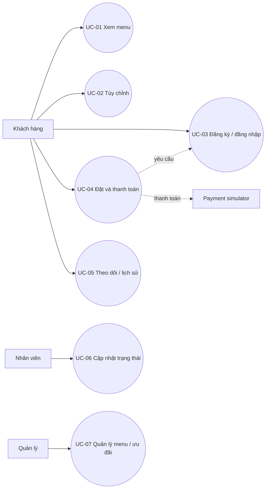

# 1.2 SRS rút gọn

## Use-case tổng quát

## Yêu cầu chức năng
| ID | Mô tả | Ưu tiên | Tiêu chí chấp nhận |
|---|---|---|---|
| FR-01 | Xem menu hoạt động | Must | GET /products trả tên, mô tả, size/giá/tồn; empty state khi rỗng |
| FR-02 | Xem chi tiết, size, topping | Must | GET /products/:id; ID lạ trả 404 |
| FR-03 | Quản lý giỏ/tổng tiền | Must | Tổng = (size+topping) × số lượng, cập nhật tức thời |
| FR-04 | Đăng ký/đăng nhập | Must | Email duy nhất, password >=8, trả JWT, không trả hash |
| FR-05 | Tạo đơn | Must | JWT hợp lệ; giá/tồn kiểm tra server; order/items/tồn atomic |
| FR-06 | Mock wallet/card | Must | Success xác nhận, fail báo thất bại; cùng Idempotency-Key không charge lần hai |
| FR-07 | Lịch sử/trạng thái | Must | Chỉ chủ đơn đọc, mới nhất trước |
| FR-08 | Nhân viên cập nhật trạng thái | Must | STAFF/MANAGER chuyển CONFIRMED → PREPARING → READY → COMPLETED hoặc hủy trước khi hoàn tất; ghi lịch sử trạng thái |
| FR-09 | Mã ưu đãi | Should | Chỉ mã active/còn hạn được áp dụng đúng tỷ lệ |
| FR-10 | Điểm loyalty | Could | Ghi earn gắn đơn khi thanh toán thành công |
| FR-11 | Dashboard CRUD menu | Won't | Ngoài MVP, menu cung cấp bằng seed |

## Yêu cầu phi chức năng
| ID | Mô tả | Ưu tiên | Tiêu chí chấp nhận |
|---|---|---|---|
| NFR-01 | Hiệu năng | Should | Menu demo <1.5s local; phân trang khi dữ liệu lớn |
| NFR-02 | Bảo mật | Must | JWT, bcrypt, DTO whitelist, CORS allowlist, không log secret |
| NFR-03 | Khả dụng | Must | /api/health truy vấn DB; Compose health check 200 |
| NFR-04 | PWA/mobile | Must | Layout từ 360px, manifest installable |
| NFR-05 | Toàn vẹn | Must | Transaction tạo đơn/trừ tồn; integer money |
| NFR-06 | Tái triển khai | Must | Migration/seed và Compose tái tạo stack |
| NFR-07 | CI/CD | Must | PR lint/test/build; deploy có smoke check và rollback |
| NFR-08 | Payment privacy | Must | Mock chỉ; không thu PAN/CVV |
