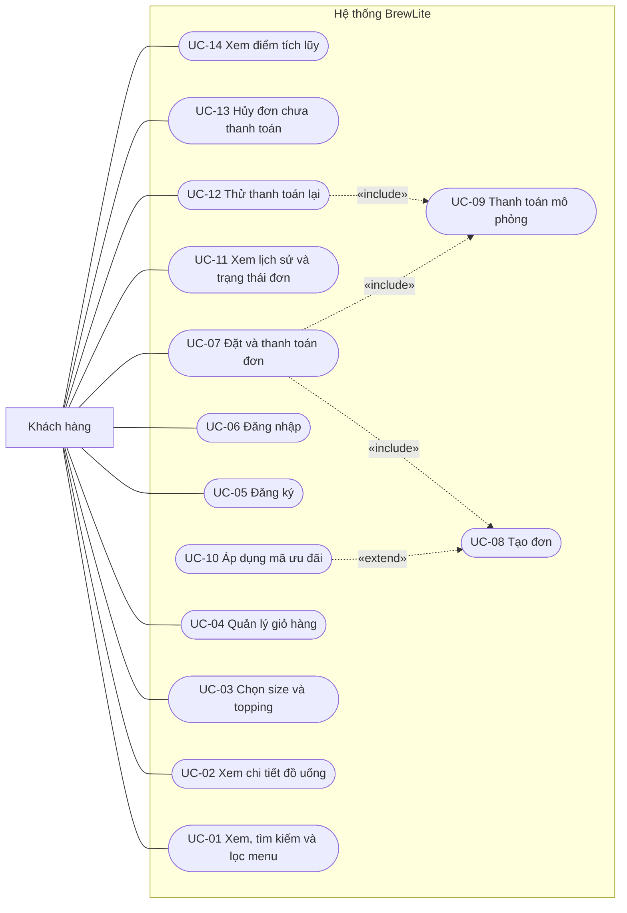
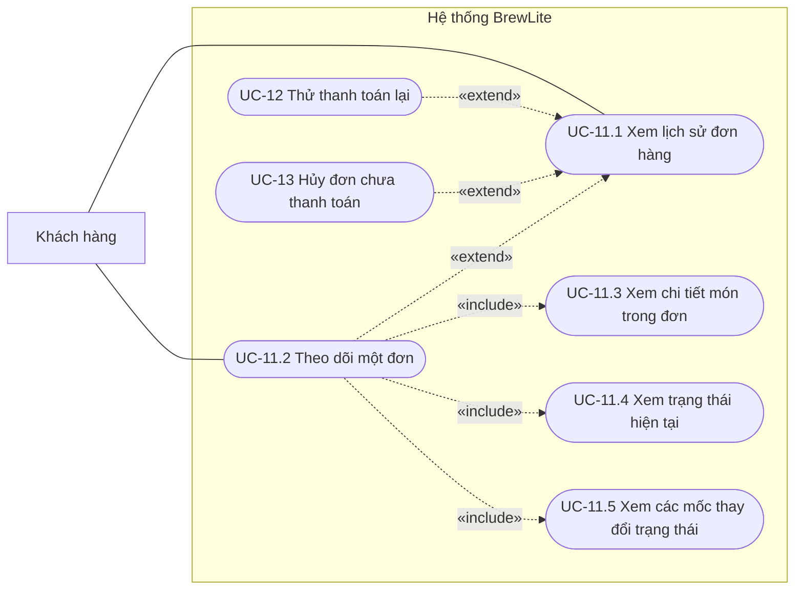
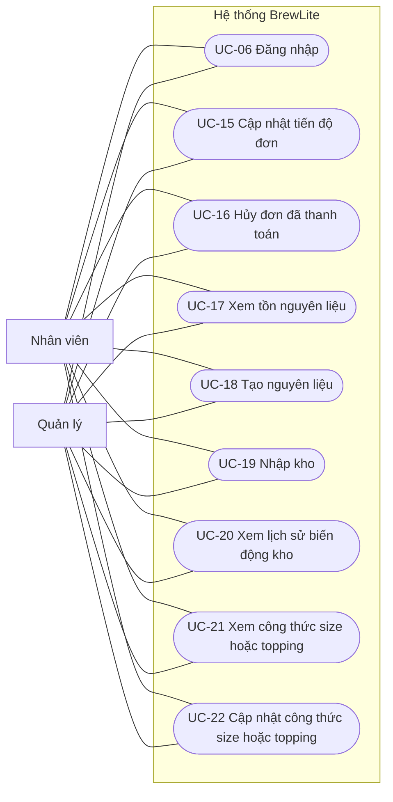

# Sơ đồ use case BrewLite

## Khách hàng đặt và theo dõi đơn

- Khách có thể xem menu, chọn size và topping, rồi chỉnh giỏ trước khi đăng nhập. Đặt đơn, thanh toán, xem lịch sử, hủy đơn và xem điểm yêu cầu đăng nhập.
- Khi tạo đơn, hệ thống kiểm tra giá và tồn, giữ nguyên liệu hoặc tồn sản phẩm tương ứng, rồi tạo đơn ở trạng thái `PENDING`. Mã ưu đãi được kiểm tra khi khách nhập mã.
- Khách chọn ví hoặc thẻ mô phỏng. Thanh toán thành công chuyển đơn sang `PAID` và ghi điểm tích lũy. Chức năng mô phỏng nằm trong BrewLite.
- Khách xem các đơn của mình. Với đơn `PENDING` hoặc `PAYMENT_FAILED`, khách có thể thử thanh toán lại hoặc hủy đơn để giải phóng phần tồn đã giữ.

### UC-11 — Xem lịch sử và trạng thái đơn

**Tác nhân chính** — Khách hàng.

**Tiền điều kiện** — Khách hàng đã đăng nhập và có JWT hợp lệ.

**Kích hoạt** — Khách chọn **Đơn hàng** trên thanh điều hướng hoặc **Xem lịch sử đơn hàng** trên màn hình xác nhận thanh toán.

**Luồng chính**

1. BrewLite lấy danh sách đơn của tài khoản đang đăng nhập qua `GET /api/orders/me` và hiển thị đơn mới nhất trước.
2. Mỗi đơn hiển thị mã đơn, thời điểm đặt, số món, tổng tiền và trạng thái hiện tại.
3. Khách bấm **Theo dõi đơn** trên đơn muốn xem. BrewLite gọi `GET /api/orders/{id}` và kiểm tra đơn thuộc tài khoản đang đăng nhập.
4. Giao diện cập nhật trạng thái của đơn đã chọn và mở chi tiết ngay trong danh sách. Khách thấy tên món, size, số lượng, topping nếu có và các lần đổi trạng thái kèm thời điểm, theo thứ tự từ cũ đến mới.

**Luồng thay thế và ngoại lệ**

- **Chưa có đơn** — Giao diện hiển thị “Bạn chưa có đơn hàng.”
- **Đơn `PENDING` hoặc `PAYMENT_FAILED`** — Khách có thể chọn **Thử thanh toán lại** (UC-12) hoặc **Hủy đơn** (UC-13) ngay trên dòng đơn.
- **JWT thiếu hoặc không hợp lệ** — API trả `401`. Nếu đơn không tồn tại hoặc thuộc tài khoản khác, API chi tiết trả `404`.
- **Lỗi khi tải danh sách hoặc chi tiết** — Giao diện hiển thị thông báo lỗi. Khách có thể bấm lại **Đơn hàng** hoặc **Theo dõi đơn** để tải lại.

**Hậu điều kiện** — Sau khi tải thành công, giao diện hiển thị lịch sử của tài khoản và trạng thái được API trả về tại lần truy vấn. UC-11 chỉ đọc dữ liệu đơn hàng.

## Nhân viên và quản lý vận hành

- Hai vai trò `STAFF` và `MANAGER` dùng cùng các quyền vận hành trên API. Tiến độ đơn đi từ `PAID` → `PREPARING` → `READY` → `COMPLETED`. Có thể hủy đơn từ `PAID` trước khi bắt đầu pha chế.
- Lịch sử biến động kho ghi nhận các thao tác như nhập kho, giữ và giải phóng nguyên liệu. Công thức size và topping xác định định mức nguyên liệu dùng để tính số lượng đồ uống khả dụng.

Đường liền biểu thị tác nhân tham gia use case. Mũi tên `«include»` chỉ hành vi được gọi bắt buộc. Mũi tên `«extend»` đi từ hành vi tùy chọn đến use case được mở rộng.

Tham chiếu [SRS](srs.md), [đặc tả đặt hàng](use-case-checkout.md) và [hướng dẫn kiểm thử kho](../inventory-thunder-client.md).
