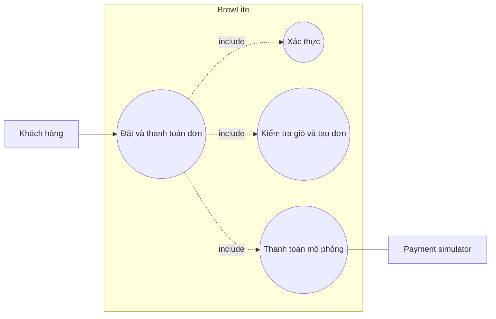

# 1.3 UC-04 Đặt và thanh toán đơn hàng

- **Actor chính:** khách đã đăng nhập. **Actor phụ:** API/DB, payment simulator.
- **Mục tiêu:** đặt các món hợp lệ và nhận kết quả thanh toán.
- **Trigger:** khách bấm Đặt hàng.
- **Tiền điều kiện:** JWT hợp lệ, giỏ không rỗng.
- **Hậu điều kiện thành công:** order/items/payment SUCCEEDED/loyalty được lưu, tồn giảm, khách thấy mã đơn PAID.
- **Hậu điều kiện thất bại:** PAYMENT_FAILED; khách được hướng dẫn thử lại.

## Luồng chính
1. UI gửi `POST /api/orders` với món, size, topping, số lượng.
2. API xác minh JWT, validate, đọc giá/tồn hiện hành từ DB.
3. API transaction tạo order/items và giảm tồn.
4. UI gửi `POST /api/orders/{id}/pay`, `Idempotency-Key` và phương thức mock.
5. API xác minh JWT và quyền sở hữu; gọi simulator.
6. API ghi Payment, cập nhật trạng thái; tạo loyalty earn nếu thành công.
7. UI hiển thị mã đơn và trạng thái; khách xem lịch sử.

## Luồng thay thế
- A1: nhiều item được validate trong cùng transaction.
- A2: mã promotion active/còn hạn được tính trước khi tạo order.
- A3: retry cùng idempotency key trả kết quả cũ, không ghi payment mới.

## Ngoại lệ
- E1 JWT thiếu/sai: 401 và yêu cầu đăng nhập.
- E2 giỏ/dữ liệu sai: 400, giữ giỏ để sửa.
- E3 hết hàng/size/topping không hợp lệ: rollback transaction.
- E4 lỗi DB: rollback order/items/tồn.
- E5 thanh toán fail: ghi PAYMENT_FAILED, thử lại bằng key mới.
- E6 đơn thuộc khách khác: trả 404.

**Trace:** FR-03–FR-07, FR-09–FR-10, NFR-02, NFR-05, NFR-08.
