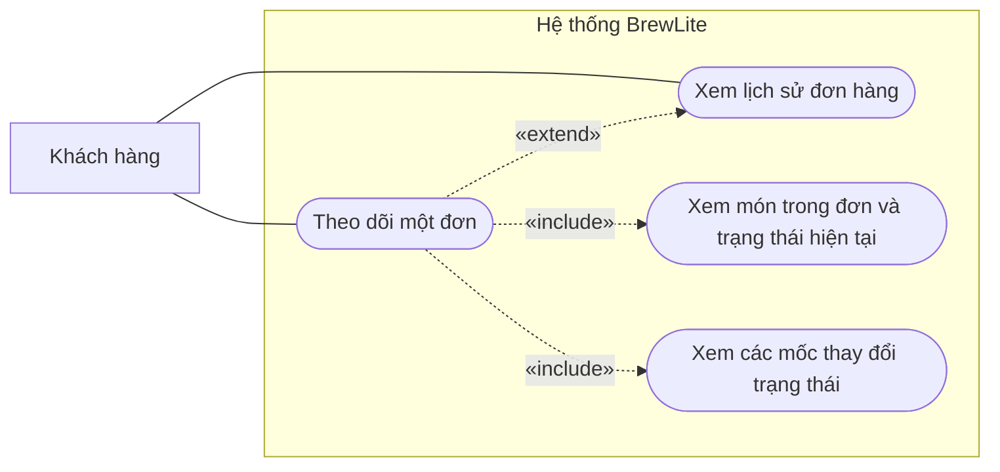

# UC-11 — Xem lịch sử và trạng thái đơn

- **Tác nhân chính** — Khách hàng.
- **Mục tiêu** — Xem các đơn đã đặt, trạng thái hiện tại và lịch sử thay đổi trạng thái của từng đơn.
- **Tiền điều kiện** — Khách hàng đã đăng nhập và có JWT hợp lệ.
- **Kích hoạt** — Khách chọn **Đơn hàng** trên thanh điều hướng hoặc **Xem lịch sử đơn hàng** trên màn hình xác nhận thanh toán.
- **Hậu điều kiện** — Giao diện hiển thị dữ liệu tại thời điểm truy vấn. Thao tác xem giữ nguyên dữ liệu đơn hàng.

## Sơ đồ use case

## Luồng chính

1. Khách mở mục **Đơn hàng**.
2. BrewLite gọi `GET /api/orders/me` kèm JWT để lấy các đơn của tài khoản hiện tại, sắp xếp từ mới nhất đến cũ nhất.
3. Giao diện hiển thị mã đơn, thời điểm đặt, số món, tổng tiền và trạng thái hiện tại của từng đơn.
4. Khách bấm **Theo dõi đơn** trên đơn muốn xem.
5. BrewLite gọi `GET /api/orders/{id}` kèm JWT. API tìm đơn theo mã định danh và tài khoản đang đăng nhập.
6. Giao diện cập nhật trạng thái của đơn và hiển thị tên món, size, số lượng, topping nếu có, cùng các lần đổi trạng thái và thời điểm tương ứng từ cũ đến mới.

## Luồng thay thế

- **A1 — Chỉ xem danh sách.** Khách có thể đóng mục **Đơn hàng** sau bước 3.
- **A2 — Chưa có đơn.** Giao diện hiển thị “Bạn chưa có đơn hàng.”
- **A3 — Đơn chưa thanh toán.** Với đơn `PENDING` hoặc `PAYMENT_FAILED`, khách có thể chọn **Thử thanh toán lại** (UC-12) hoặc **Hủy đơn** (UC-13).

## Ngoại lệ

- **E1 — JWT thiếu, hết hạn hoặc không hợp lệ.** API trả `401 Unauthorized`.
- **E2 — Đơn không tồn tại hoặc thuộc tài khoản khác.** API chi tiết trả `404 Not Found`.
- **E3 — Yêu cầu tải danh sách hoặc chi tiết thất bại.** Giao diện hiển thị thông báo lỗi. Khách có thể chọn lại **Đơn hàng** hoặc **Theo dõi đơn** để tải lại.

**Yêu cầu liên quan** — FR-07 về lịch sử và trạng thái đơn, FR-08 về cập nhật và hủy đơn. [SRS](srs.md) · [Sơ đồ use case tổng quan](use-case-brewlite.md)
